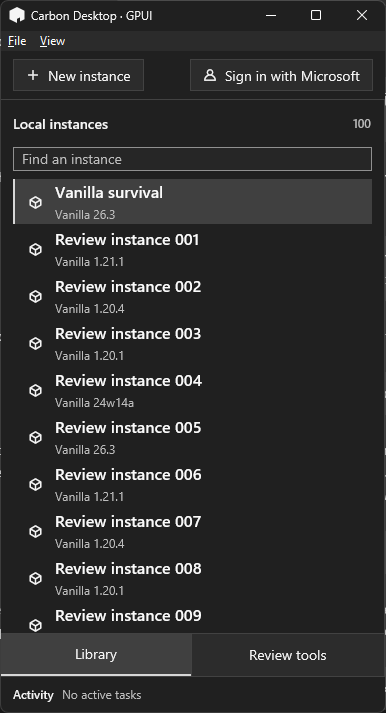
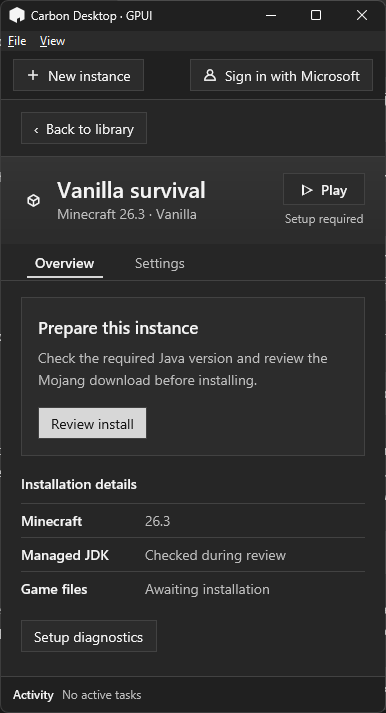

<!-- SPDX-License-Identifier: MPL-2.0 -->

<div align="center">
  <h1>Carbon Desktop</h1>
  <p><strong>A native Minecraft Java launcher in development for Windows, Linux, and macOS.</strong></p>
  <p>Organize local instances, review what each version needs, and prepare its game files and Java runtime from one desktop workspace.</p>
  <p>
    <a href="#quick-start">Quick start</a> ·
    <a href="#what-you-can-do">Features</a> ·
    <a href="#project-status">Project status</a> ·
    <a href="LICENSE">MPL 2.0</a>
  </p>
</div>

<picture>
  <source srcset="https://carbon-mine.github.io/carbon-desktop/library-wide.png">
  
</picture>

*A wide library view in the GPUI edition. The automated screenshot is published from protected main; the bundled `docs/images/gpui-library.png` image is the documented fallback until the first public publish is verified.*

## What you can do

- **Organize your instances.** Create, edit, and clone vanilla profiles. Search the local library, set memory and starting window size, and open an instance’s private game folder.
- **Review and prepare an installation.** Review the download size first, then fetch the version’s game files directly from Mojang and install a matching Eclipse Temurin JDK in Carbon’s application storage. Follow progress, cancel, or verify prepared files offline.
- **Import a local modpack.** Review a Modrinth `.mrpack` before creating its own instance. Carbon copies the reviewed overrides and records any loader or dependencies still required.
- **Use a desktop workspace.** The library and selected instance sit side by side in wide windows. At narrow widths, Back to library and Escape return to the instance list. The GPUI edition has native file pickers, keyboard navigation, and System, Light, and Dark appearance settings.

<table>
  <tr>
    <td>
      <picture>
        <source srcset="https://carbon-mine.github.io/carbon-desktop/library-compact.png">
        
      </picture>
    </td>
    <td>
      <picture>
        <source srcset="https://carbon-mine.github.io/carbon-desktop/instance-compact.png">
        
      </picture>
    </td>
  </tr>
  <tr>
    <td align="center">Search and select an instance.</td>
    <td align="center">Review setup in the selected instance.</td>
  </tr>
</table>

*Compact screenshots are published from protected main to GitHub Pages; the bundled `docs/images/gpui-narrow-library.png` and `docs/images/gpui-narrow-instance.png` images remain the documented fallback until the first public publish is verified.*

## Quick start

### Native GPUI edition

Use a stable Rust toolchain. On Windows, install the MSVC C++ build tools and Windows SDK. On Windows x64, a JDK with `javac` enables the optional protected Java sample. On Linux, use a graphical session with Vulkan support and install the C toolchain, `pkg-config`, and OpenSSL, fontconfig, FreeType, XCB, and XKB development libraries.

On macOS, install Xcode with its Metal compiler and CMake. The [CI guide](docs/ci.md) lists the native prerequisites and toolchain versions for each target.

From this repository, run:

```sh
cargo run --locked -p carbon-desktop-gpui -- --comparison-review
```

The comparison flag opens a temporary library with sample profiles. Run without the flag to keep changes in your normal Carbon Desktop library.

Select an instance, then choose **Review install** to inspect its download plan. **Install instance** prepares the reviewed files and the required JDK. **Verify game files** checks the result offline.

## Project status

Carbon Desktop is a development preview. Vanilla setup and offline verification are available. The Play action leads to setup and account requirements. Protected Minecraft launch, authenticated multiplayer, and full mod-loader installation are still in development. Microsoft sign-in requires an approved application registration.

The project targets x64 and ARM64 on all three operating systems. The current managed JDKs and private game installations support Windows x64 and Linux x64. macOS and ARM64 are build targets while their runtime setup and gameplay are in development. See the [CI matrix](docs/ci.md) and [runtime qualification](docs/runtime.md).

On macOS, GPUI's File and View menus and native accessibility adapter are still pending. Interactive macOS qualification remains open.

The [GPUI application](crates/gpui-launcher) is the sole active frontend. The former Svelte/Tauri shell is preserved as a historical design reference. Shared Rust code owns [profiles](crates/profiles), [Java runtime preparation](crates/runtime), [vanilla installation](crates/vanilla), and [pack import](crates/pack).

## License

Carbon Desktop source is available under the [Mozilla Public License 2.0](LICENSE). Bundled and inherited material retains its own license and notices. See the [third-party notices](third_party) and [inherited design assets](design-system/inherited).
