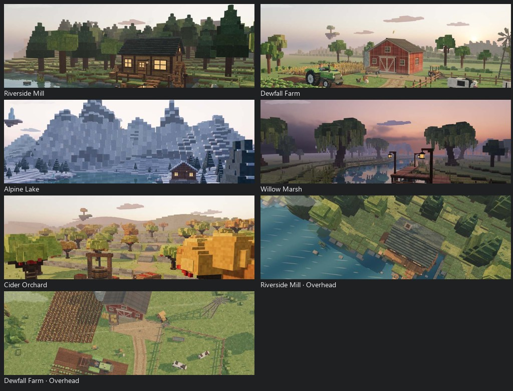

# Native Home landscapes

Carbon Home has five original voxel landscapes and seven views. Riverside Mill and Dewfall Farm also have overhead cameras. A player's world map uses its own data. Each camera makes a gentle 0.69-degree arc over an eight-second cycle. A drifting block cloud deck and directional sunlight connect the scenes. Their ground-level motion comes from the site itself.

| Landscape | Motion and visual anchors |
| --- | --- |
| Riverside Mill | Wheel spray, expanding foam rings and water leaving the wheel |
| Dewfall Farm | Chaff rises from the wheat bed, moving awns catch the light, windmill blades turn |
| Alpine Lake | Intermittent gusts lift powder off four snowbanks; short glints move on the lake |
| Willow Marsh | Fireflies drift within reed beds, with subdued rings on the water below |
| Cider Orchard | Leaves and pale petals descend from tree crowns and dappled light moves beneath them |

At the measured 1366 × 586 centered Home crop, the scenic cameras aim lower to show the orchard press and cart, the mill outlet, farm bed, reed banks and lake. The alpine lens also widens to retain the mountain silhouette. The overhead views look down on the same wheel and field effects as their scenic counterparts. Each loop samples phase zero through the last frame before phase one. The baker compares the end pose against the first. Wind continues forward through the camera's turn.



## Playback measurements

These samples used a standalone native Windows x64 GPUI scene and the JPEG frame-pack renderer, before the wider composition and AVC export. Each row covers ten seconds in the development profile. The probe sampled changed pixels through Win32 PrintWindow with approximately 12–18 ms capture resolution. CPU came from a separate four-second interval and includes the probe's command poll.

| Client pixels | Baseline fps | 30 fps pack observed fps | Baseline interval p50 / p95 | Updated interval p50 / p95 | CPU before / after, % of one core |
| --- | ---: | ---: | --- | --- | --- |
| 704 × 445 | 4.4 | 29.9 | 230 / 255 ms | 36 / 49 ms | 64 / 32 |
| 960 × 540 | 4.1 | 30.0 | 243 / 279 ms | 36 / 48 ms | 68 / 26 |
| 1368 × 720 | 4.0 | 29.4 | 243 / 291 ms | 36 / 54 ms | 68 / 52 |

Paused captures stayed pixel-stable, including after minimizing and restoring. Resuming advanced the image again. At the widest size, 48 fps and 60 fps Riverside packs yielded 42.9 and 52.1 observed changes per second respectively. The seven JPEG packs at 30, 48 and 60 fps occupied 88.9, 142.3 and 177.8 MB. Source cadence, window capture cadence and physical display presentation are distinct measurements.

## Rebuilding the scenery

Install Chrome and Node.js, then run the following from `tools/landscapes`. Set `CHROME_PATH` to select a particular Chromium executable.

```sh
npm ci
npm run bake
```

The scene sources, original voxel models, camera definitions, sky lighting and siding material live under `tools/landscapes`. All geometry is defined in source. The baker runs offline after package installation, with all assets inlined. It rejects page errors and insufficient variation between frames. The observed Windows bake used Chrome 158.0.8127.88 and qualified distinct frame content for all seven views. Hardware, browser and encoder versions can affect rendered bytes. [Materials, source links and reuse terms](../../tools/landscapes/assets/ASSETS.md)

`--size WIDTHxHEIGHT` and `--view ID` also work without an export directory, which re-authors the bundled poster and frame pack in place at that size. Without `--view`, an in-place bake re-authors every authored view. The bake renders the canvas natively at the requested size up to 8,294,400 pixels (3840 × 2160), with no edge above 4,096 pixels, and fails rather than upscaling a smaller canvas. For example, `npm run bake -- --size 2560x1440 --view orchard` re-authors only Cider Orchard at 2560 × 1440. The checked-in packs stay 960 × 540.

To render the authored scenes into a new external directory, install FFmpeg with libx264 and ffprobe. The AVC exporter streams original PNG pixels directly into the encoder. It writes a matching first-frame JPEG and a silent 1440 × 810 H.264 Main clip per view, at 30 fps with one opening keyframe per eight-second cycle. It verifies the closing pose and encoded frame count, timing and color metadata before publishing either output. Set `FFMPEG_PATH` and `FFPROBE_PATH` to use specific binaries.

```sh
node bake.mjs --avc-dir ./review-avc
node bake.mjs --png-dir ./review-master --size 1440x810 --view farmland --frames 60
```

The encoder uses a symmetric quality schedule to limit the texture change between the final predictive frame and the opening keyframe. Compare the seam against all 239 other transitions in the decoded container:

```sh
node check-loop.mjs ./review-avc/farmland.mp4
node --test avc-export.test.mjs source-config.test.mjs
```

The check records adjacent-frame RGB error on a 384 × 216 image, including the highest 24 × 18 block error at the join. It fails when the join exceeds the 95th percentile for the full clip. A comparison across all seven corrected encodes gave mean seam differences of 0.14–0.27 on a 0–255 scale; the previous one-second GOPs gave 0.67–1.06. The seven movies occupy 84,320,139 bytes in the qualified Windows bake.

For the JPEG playback path, each `.frames` file starts with a little-endian 32-bit frame count followed by `count + 1` little-endian 32-bit offsets relative to the first byte of the JPEG payload. Each successive pair defines one independent image, including the terminal offset. Playback needs only the current frame and one decoded successor. JPEGs are decoded on demand. The desktop does not need Chrome, Three.js or an online service to show these scenes.

## Add a bundled view

Add its offline JPEG poster, optional frame pack and an entry in [manifest.json](manifest.json). Each view has a stable lowercase ID, a stable family shared by the perspectives of one landscape, a human-readable name and attribution. Keep IDs stable across visual revisions so saved choices reopen. A scenic-only scene needs one entry. A second angle gets another entry in the same family. The order in the manifest is the chooser order. The generated catalog supplies lookup and the candidates for shuffle.

Include both `frames` and `fps` for motion. Omit both for poster-only artwork. The build accepts 1–60 frames per second. Carbon ships the current seven views at 30 with `"playback":"loop"`. Forward loops continue through the last-to-first seam in sequence. Omitting the field preserves the original back-and-forth playback for existing assets. The build requires regular local assets and rejects duplicate IDs, missing attribution, unsafe filenames and unsupported manifest versions. Initial display and motion-decoding recovery use the checked-in poster. Pausing retains the current camera frame. Each frame pack is decoded off the UI thread, one image at a time. The previous atlas image is retired after painting. Hidden and reduced-motion behavior is controlled by the Home view's playback state.

Run `cargo test --locked -p carbon-desktop-gpui --lib`. The build also compiles a test-only catalog with an additional scenic-only perspective. The test locates it through the same catalog scan, checks its family, opens its packaged poster and motion stream, selects it with the production shuffle algorithm, and confirms it stays outside the shipped chooser. Ordinary builds use the assets directly and skip the artist's bake. Forks can provide their own compatible poster and frame pack without changing the native renderer or launcher UI.


The optional `bake` object identifies an explicit authoring source and camera, for example `{"source":"farmland","camera":"overhead"}`. Stable view IDs can be renamed independently of this binding. The authoring source registry maps names to actual local geometry modules and camera vectors. The build rejects unknown sources and cameras. Imported finished assets omit `bake` and are never overwritten by the baker. To author a new model, add its local geometry module and named camera definitions to [the source registry](../../tools/landscapes/sources.json). To reuse a finished pack and poster, only add the manifest record and the assets.
