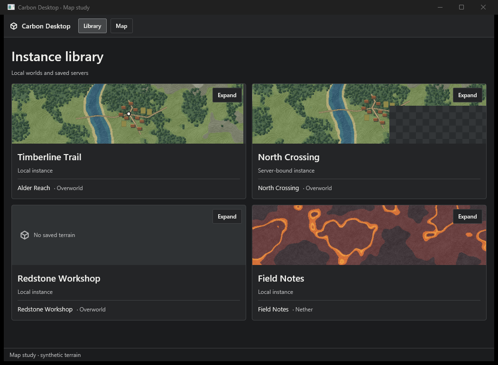

<!-- SPDX-License-Identifier: MPL-2.0 -->
# Review the native world map

This GPUI example lets a reviewer open the map featured on an instance, inspect a different world, and move that map into a separate native window. The fixtures use original synthetic imagery. The example reads no saves, credentials or launcher settings.



At 418 pixels wide, each tile becomes an instance icon, two lines of identity, its world and dimension, and an Expand button. The wider layout keeps the same information below a scenic crop. Inspect the terrain marker on Alder Reach, the checkerboard on North Crossing, and the empty Redstone Workshop preview. Browsing leaves each tile’s featured world unchanged.

[Compact library](native/library-compact.png) · [Native fullscreen](native/fullscreen.png) · [Detached partial terrain](native/detached-partial.png) · [Detached empty map](native/detached-empty.png)

## Run the study

Use the pinned tools and platform prerequisites in the [build runbook](../../implementation.md) and [GPUI guide](../../gpui.md). From the repository root, run the following commands.

```sh
bun install --frozen-lockfile
bun run build
python design-system/verify_seed.py
cargo run --locked -p carbon-desktop-gpui --example map_study
```

For the Windows build with embedded shaders, set the SDK compiler path in PowerShell.

```powershell
$env:GPUI_FXC_PATH = Get-ChildItem 'C:\Program Files (x86)\Windows Kits\10\bin\*\x64\fxc.exe' |
    Select-Object -Last 1 -ExpandProperty FullName
cargo --config 'profile.dev.package.gpui.debug-assertions=false' --config 'profile.dev.package.gpui-component.debug-assertions=false' run --locked -p carbon-desktop-gpui --example map_study
```

## Try the interaction

1. Expand **Timberline Trail**. Alder Reach opens in native fullscreen, centered on its recorded position. Use the arrow keys or drag to pan. Use the wheel or zoom buttons to change scale. Center returns to the recorded position, or the center of the terrain when its position is unknown.
2. Choose **Separate window**. It starts with the same world, dimension and camera. Change that window to **North Crossing** to view partial coverage, then choose **Timberline Trail → Alder Reach SMP** for the empty state. The original window keeps its own selection and camera. A separate window can stay open while the main library is in use.
3. Close the separate window. Press Escape in the expanded main window. The launcher returns to the same tile and restores focus to its Expand button. Press Enter to reopen it. The visible Close button also exits fullscreen.
4. The main **Map** workspace allows independent map selection before entering fullscreen or detaching. All camera and view changes are input-driven, with static transitions.

## Windows checks

The x64 test ran the ordinary GPUI example on an isolated Win32 desktop. Windows UI Automation invoked the named Expand button, read passive world and dimension labels, and reported the focused Expand button after Escape. The 1050 × 770 window entered the monitor’s full 2560 × 1440 bounds. Enter reopened the same map. The visible Close restored its original bounds.

The detached map opened as a second, independently selectable native window. Changing its map left the original terrain pixels identical in the central viewport. The compact 418 × 720 library, 850 × 630 detached map, and fullscreen captures came from the individual window handles. These checks exercised keyboard pan and button zoom. A live screen-reader walkthrough, pointer-device feel, cross-monitor scaling, and native Linux and macOS checks remain open.

This study demonstrates the native presentation and window interactions. The two bundled terrain rasters and their generator are shared with the browser study. The native candidate limits imagery to those bundled rasters. Real gameplay observation, map extraction, and server-to-world identity are tracked separately. [Design review](https://carbonpanel.atlassian.net/browse/CDESK-86) · [World entry](https://carbonpanel.atlassian.net/browse/CDESK-84) · [Map tiles](https://carbonpanel.atlassian.net/browse/CDESK-85)
