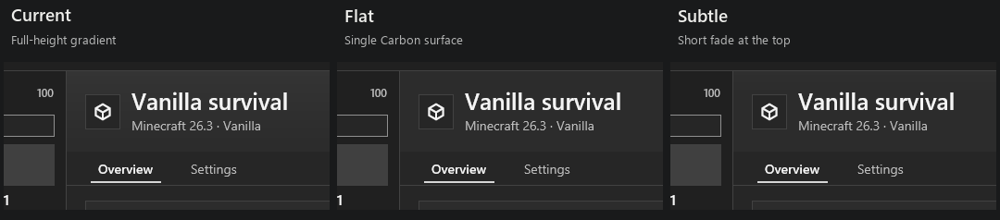
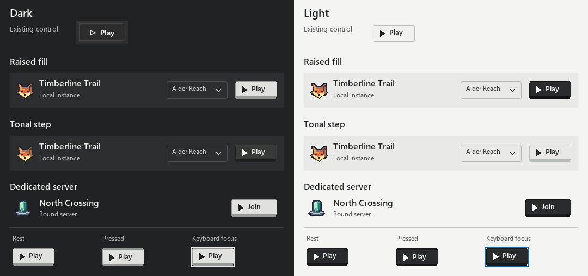
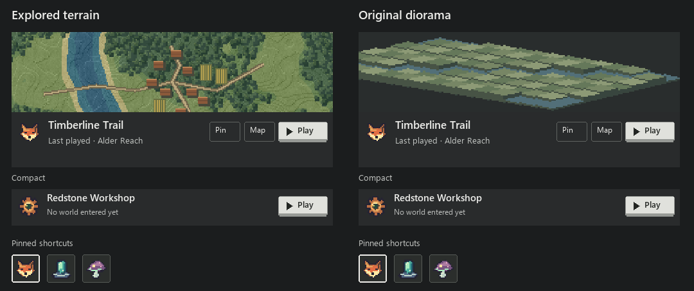
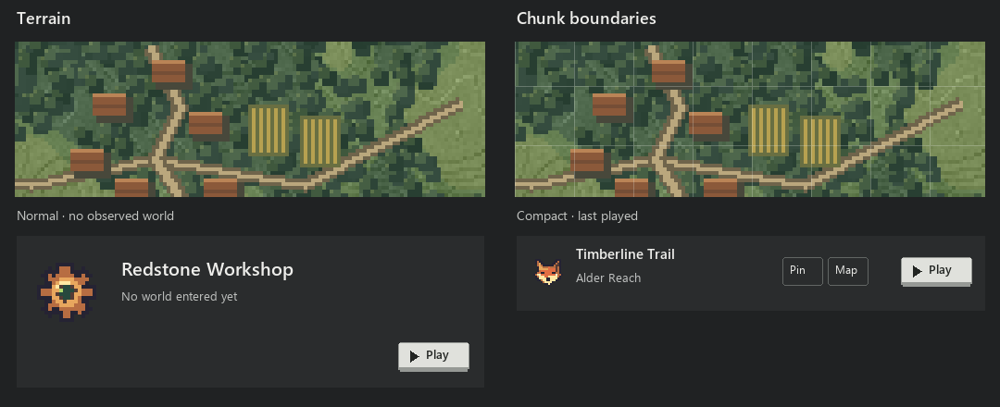

<!-- SPDX-License-Identifier: MPL-2.0 -->
# Native instance panel and launch controls

## Panel surface

**Provisional recommendation: flat.** The flat header reads as one surface behind the instance name, Play and its status. The lighter title and weight already establish hierarchy. In the current version the upper edge also makes a horizontal stripe between the toolbar and tabs. The subtle variant is a viable option for keeping the landing-page bloom at the very top.

These are actual GPUI windows on Windows x64 at 96 DPI, 1100 × 740 native pixels. All three show Vanilla survival, Minecraft 26.3, first selected in the same 100-instance synthetic comparison library, dark theme, Overview. The focus and adjacent panels stayed in the same positions. The review ran on a separate Win32 desktop. Only the header fill changed. Source base e4bab16, using the isolated [study patch](reproduce-surfaces.patch). Apply it to that base, set CARBON_SURFACE_STUDY to current, flat or subtle, and run the GPUI launcher with --comparison-review. The production default is unchanged.

| Variant | Sampled header, top to bottom | Relationship to adjacent panels |
| --- | --- | --- |
| [Current native window](current.png) | #343434 to #2c2c2c | Largest light step from the #202020 library at the top. |
| [Flat native window](flat.png) | #2c2c2c throughout | Consistent separation from the #262626 tab strip. |
| [Subtle native window](subtle.png) | #2f2f2f to #2c2c2c in the first quarter | The lower header reads like flat, with a small lift near the toolbar. |

At the brightest top pixel, nominal title ink #f4f4f4 and secondary ink #bdbdbd both remain legible. The lowest calculated ratios across the three surfaces are 11.3:1 and 6.6:1 respectively. These measurements use solid text and background values, before font antialiasing. See the [visual acceptance story](https://carbonpanel.atlassian.net/browse/CDESK-92).

## Compact launch controls

The top dark button is cropped from the native capture. The light baseline and all alternatives are static drawings at 96 DPI. The two choices below it show the same information. The filled action is easier to find next to the destination chooser. Its original two-pixel shoulder and short lower edge compress when pressed while the outside hit area stays fixed. The tonal version gives terrain and portraits more visual weight. Both retain Carbon type and reserve pixel art for instance identity. I recommend the filled action for a player who needs to find Play immediately.

Use a separate 112 × 32 destination chooser on a general instance. Choosing Alder Reach selects the next launch target without starting the game or changing its last-played world. Tab reaches the chooser and action separately. Enter opens the focused chooser or activates the focused action. Escape closes the chooser and returns focus. A bound server presents a single Join action. When direct connection is unqualified, expose Open Minecraft and Copy server address through the server flow. The mockups depict the available state. They do not establish executable game or loader support.

Mojang’s February 2024 screenshot shows a large green central Play control, the selected installation nearby, and a row of block-icon shortcuts at the upper right. Its Quick Play article describes recently played worlds and pinning. The screenshots and game logos remain with Mojang. Carbon uses original compact geometry and an independent name, palette, icons and typography. The official installation/update page also places Java version selection in the launcher. These are dated public references. No local official account was opened. [Official screenshot](https://www.minecraft.net/content/dam/minecraftnet/games/minecraft/screenshots/Quickplay-launcher.jpg) · [Quick Play](https://www.minecraft.net/en-us/article/quick-play-coming-java-and-bedrock-edition) · [Installation and update instructions](https://www.minecraft.net/en-us/updates/instructions)

## Terrain, art and personalization

Prefer the player's last successfully entered world and dimension when a qualified map exists. The map source in this study is synthetic. The separate Pin, Map and Play targets let a player change favorites or explore without altering the observed visit. When compact or missing coverage, use the instance sprite and a short empty state. An optional decorative voxel scene needs a distinct appearance and a descriptive label so it cannot be mistaken for a recording of the player's world. In the actual Map view, an optional chunk grid can help at close zoom. Align it to world coordinates. Hide it when zoomed out, reduce its opacity over terrain and keep uncovered cells visibly empty. See the [runnable native map study](https://github.com/carbon-mine/carbon-desktop/pull/15).

Explore local appearance packs as **data only**. A proposed v1 manifest has a stable ID, display name, format version, semantic color slots, sprite slots, asset paths, author and SPDX license or renewal-free permission reference per asset. Document source artwork and an editable palette separately. An importer could accept bounded PNG assets plus JSON, validate paths and sizes before decoding, and preview changes in a disposable view. Use only relative files in the pack, refuse executable content, external URLs and traversal, and leave the current appearance intact after validation failure. Keep user packs outside game directories and trust boundaries. Bundled defaults work offline. Unknown optional slots use the bundled asset. Reject an unsupported schema major with an actionable message. Keep command glyphs and high-contrast/focus affordances under the shell’s control. Export the manifest, approved assets and notices together. A fork can replace built-ins without Carbon hosting or a mod registry. Skin profile and game entitlement checks are independent.

Prism documents local icon packs and distinguishes icon themes from widget themes. Kenney’s Voxel Pack is an example of a separately licensed, replaceable asset set. The sprites used here are original Carbon artwork from the icon study. No third-party pack, Mojang artwork or Minecraft font was incorporated. Before publicizing artwork, review Mojang’s naming, branding and endorsement guidance and the specific license of every asset. [Prism themes](https://prismlauncher.org/wiki/getting-started/change-themes/) · [Kenney Voxel Pack](https://kenney.nl/assets/voxel-pack/) · [Mojang usage guidelines](https://www.minecraft.net/en-us/usage-guidelines)

[Compact launch design](https://carbonpanel.atlassian.net/browse/CDESK-93) · [Local appearance packs](https://carbonpanel.atlassian.net/browse/CDESK-94) · [Icon source and picker](https://github.com/carbon-mine/carbon-desktop/pull/13)

The owner selects the surface and controls at visual review. Production changes follow in separate reviewed native PRs.
