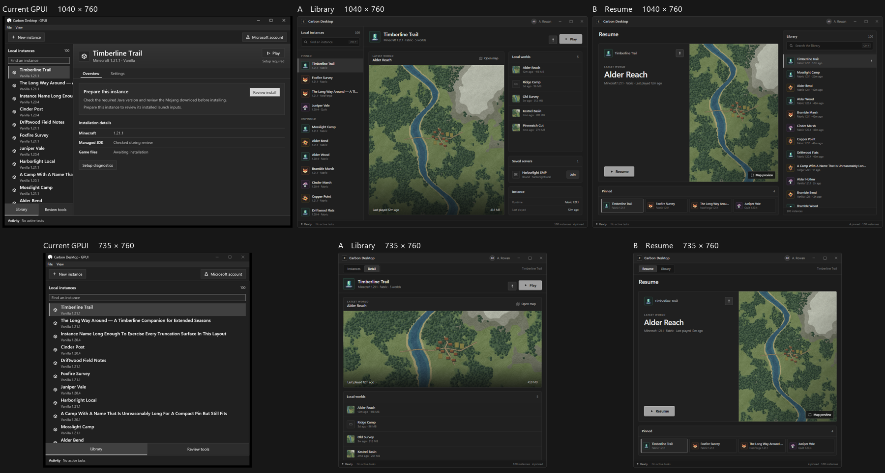

# Library or Resume

[Open the interactive comparison](layout.html) locally at 100% browser zoom. Choose a single proposal for an actual-size view. Compare fits both windows on screen. The PNG links below preserve the original pixels.

| Window | Current Windows GPUI | A · Library | B · Resume |
| --- | --- | --- | --- |
| 1040 × 760 | [Current](baseline-1040.png) | [Library](a-1040.png) | [Resume](b-1040.png) |
| 735 × 760 | [Current](baseline-735.png) | [Library detail](a-735.png) | [Resume](b-735.png) |

**Recommendation.** Use A as the launcher's starting view. On a wide desktop, the searchable library stays visible while the player compares local worlds and saved servers. A 190–290 px rail limits how much width it can take. B gives the returning player a prominent last-world tile and four pin shortcuts, but buries the per-instance worlds and servers that matter for pack management. At 735 px both designs need a pane change to browse and inspect. Choose B if returning to the latest world is the primary job on startup.

## Try the decision

1. Compare both layouts at 1040 × 760. On A, use the rail separator's arrow keys to change its width. In either proposal, open the latest map and press Escape. Focus returns to its Map control.
2. Activate Play or Resume on Timberline Trail. The simulated result identifies Alder Reach. Close it. Press Ctrl+F and find the unpinned Driftwood Field Notes. Selecting it keeps its own identity and map availability.
3. Switch to 735 × 760. Use Instances and Detail in A or Resume and Library in B. Check how many steps it takes to reopen the selected instance and whether an unpinned instance remains easy to locate.

## What ran

The baseline images are captures of the Windows GPUI executable built from e4bab16, on an isolated Win32 desktop at 96 DPI. Outer window dimensions were measured before capture. A disposable library supplied the same 100 profile names and Minecraft versions used in both proposals, including names up to 77 characters. Current GPUI shows its real installation state. The locally rendered HTML proposals add synthetic worlds, servers, instance artwork, pins and map availability for the navigation exercise. Map imagery is the existing original Alder Reach fixture. All launch actions are simulated. Account, install and settings commands are outside this navigation prototype.

The two proposals passed 17 built-in checks, including filtering without changing selection, rail bounds, no-map states, pinning, keyboard focus and one-pane navigation. Open the file with `?selftest=1` and inspect `#self-test-report` for the results. A second Playwright run used real browser key events in each of the four layout and width combinations. It returned focus to the Map control on Timberline Trail, identified Alder Reach as the launch target, and reached Driftwood through keyboard search. It observed zero network requests and no page errors.

CDESK-95 tracks measurement of the official launcher's fresh window. Its size remains unverified. An owner layout decision and a repeat at that measured size precede production shell changes.

Cinder Post has no recorded map. Inspect the [wide library empty state](a-empty-1040.png) and the [compact Resume empty state](b-empty-735.png).
