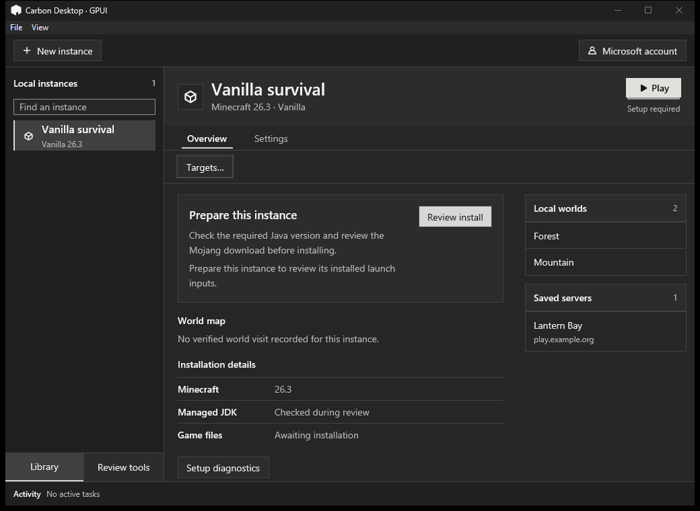

<!-- SPDX-License-Identifier: MPL-2.0 -->
# Library world previews

The Library keeps its current instance task, launch control, saved destinations and local worlds available independently of map support. When there is no confirmed visit it shows the next task first and a single line explaining the empty map. A real decoded map moves ahead of the task when available. Partial coverage is labeled and the decoder leaves unexplored pixels transparent.

## Evidence boundary

The current launcher can inventory saves and remember a chosen launch target. Its protected gameplay path has no qualified world-entry observer or map decoder yet. The Library therefore opens with no recorded visit. The map example on the design branch uses generated terrain and supplies no data to the launcher.

`WorldPreviews` lives in the Rust profiles service. A future qualified observer calls `record_confirmed_entry` after successful game entry, including an in-game destination change. The observer assigns a strictly increasing sequence for the instance across its game sessions and supplies the actual local world or normalized server identity, dimension and display name. Opening details, selecting a target, requesting a connection, starting Java, failed joins and cache timestamps do not feed this interface.

The provider receives an entry key. Its `update_map` result applies only while the instance, sequence, destination and dimension still match. Use successively increasing request revisions within the entry. A preparation update can finish once at its original revision. A stale callback cannot change the current visit, and missing or unreadable imagery preserves the recorded world's identity. The native UI accepts a decoded image handle rather than a file path. The provider is responsible for validating dimensions, bounding resources and confining file access before publishing a handle.

This slice holds observations in memory. A qualified observer, private persistent visit records across launcher restarts, native gameplay confirmation and offline reading of real map data such as JourneyMap remain outstanding. The Library does not ship a decorative terrain fallback.

## Verification

```sh
cargo test --locked -p carbon-profiles world_preview
```

Tests create an actual local library and select a save, without producing evidence of entry. They also cover re-entry, dimension and server changes, per-instance isolation, delayed map completions and unavailable imagery.


The native Windows run below opened a 1040 × 760 launcher with two disposable save folders and a saved server. A UI Automation check confirmed the current task and map status remained accessible and that opening Targets and saving a destination produced no map image.


