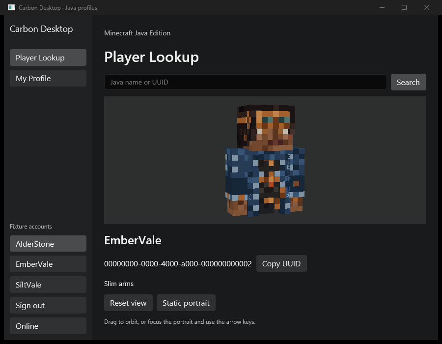
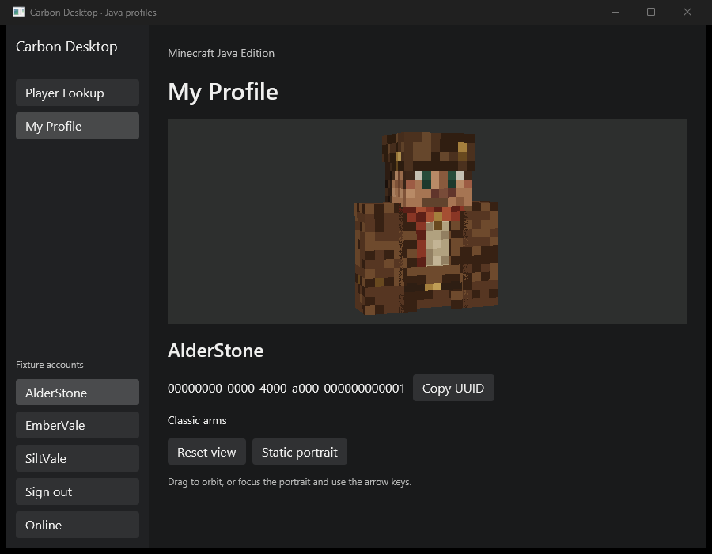

<!-- SPDX-License-Identifier: MPL-2.0 -->
# Java identity and skin review

Player Lookup searches an exact Java profile name or UUID. My Profile follows the active account. Search has its own selection and request lifetime so switching accounts leaves the lookup result intact. GPUI is the sole active frontend. The skinview3d comparison records earlier web-renderer research. The review uses invented identities and original 64 × 64 textures. Friends and Xbox social integration are deferred.

## Service access

| Read operation | Route to qualify | Access and evidence |
| --- | --- | --- |
| Exact name | GET api.minecraftservices.com/minecraft/profile/lookup/name/{name} | Candidate public route. Verify permitted use, caching, throttling, unknown-name status and a consenting test identity before enabling. Keep tokens out of public requests. |
| UUID, current name and public skin | GET sessionserver.mojang.com/session/minecraft/profile/{undashedUUID} | Candidate public session-profile route. Validate response UUID and the bounded texture metadata, accept only the intended first-party texture origin and validate image type/dimensions before decoding. Public reachability does not document Carbon-specific usage terms or quotas. |
| Active signed-in Java profile | GET api.minecraftservices.com/minecraft/profile | The existing Rust account service already requests this behind its Minecraft bearer token. Carbon's own approved application, consent and an entitled account are required for an end-to-end test. Retain tokens in the backend. Identify the active skin and its declared model. |

Mojang publishes a third-party application review process. The short help link returned its support site shell during this investigation. The Game Service Access link redirected to the application form. Carbon's approved registration reference has not been supplied. The XMCL source is an archived implementation reference for the authenticated self-profile schema and request; it does not authorize this application. A separate open-source client illustrates the two public lookup routes. [Mojang application process](https://help.minecraft.net/hc/en-us/articles/16254801392141) · [Application form](https://aka.ms/mce-reviewappid) · [XMCL implementation](https://github.com/Voxelum/minecraft-launcher-core-node/blob/master/packages/user/mojang.ts) · [Public lookup implementation](https://github.com/mcrtabot/mcface)

For a live test, compare an exact name with both UUID spellings for the same consenting identity. Check a missing player, unavailable texture and stale cached identity separately. Treat HTTP 429 as throttling and honor Retry-After. Keep an offline lookup without cached data distinct from the last known result with a timestamp. Expired self-profile requests cannot populate another active account. Request only the official sign-in interaction when registration is ready.

## Renderer comparison

Skinview3d provides a Three.js viewer, classic/slim arm support, skin layers and camera controls. Its examples also animate a whole figure. For a bust-only desktop view, crop the camera to head and shoulders and disable automatic rotation. Pausing character animation alone does not demonstrate idle rendering has stopped. Measure render counts after the last interaction and after hiding the window. MIT code and any font or example textures have separate provenance. This review uses original textures. [skinview3d project and license](https://github.com/bs-community/skinview3d)

The alternative is a small shared Rust cuboid renderer. It projects pixel-textured geometry only when the skin, pose or size changes. The GPUI study caches the last rendered pose and displays a fixed portrait when interaction is disabled. Compare front, three-quarter, back and near-side views of both arm models, including translucent outer layers. Keep the face and shoulders visible at the small window size. Use keyboard rotation and a named reset action alongside drag.

[Player Lookup](https://carbonpanel.atlassian.net/browse/CDESK-87) · [My Profile](https://carbonpanel.atlassian.net/browse/CDESK-89) · [Deferred Friends](https://carbonpanel.atlassian.net/browse/CDESK-88)

## Run the native fixture

```sh
cargo run --locked -p carbon-desktop-gpui --example profile_study
```

Search for AlderStone, EmberVale or SiltVale. Each UUID is displayed beside a Copy action. Switch fixture accounts in the sidebar and open My Profile. SiltVale has no available skin. The fixture connection control cycles between online, offline and throttled. Rotate a portrait by dragging or using arrow keys and return to its initial view with Home. Use Static portrait for a fixed front view. Names and skin bytes come only from the fixture. Production network and sign-in wiring remain on the Jira stories.

## Windows review

| Player Lookup with EmberVale, slim arms | My Profile with AlderStone, classic arms |
| --- | --- |
|  |  |

[My Profile with a missing skin](captures/native-missing.png)

Both windows above were captured from the native GPUI example at 900 × 700 pixels on Windows. In the interactive check, Right changed the portrait pixels and Home restored the original pose. With Static portrait selected, Right left the portrait pixels unchanged. Switching to SiltVale in My Profile showed its missing-skin state. Returning to Player Lookup preserved EmberVale and its displayed details. The sign-out and fixture sign-in controls were exercised in the same window. Live browser sign-in, public lookup service behavior, assistive technology and native Linux desktop interactions remain to be verified separately.

Run the model and rendering checks with the following command. They cover name and UUID aliases, invalid versus unknown inputs, texture orientation, arm width, transparency and both bundled character skins.

```sh
cargo test --locked -p carbon-desktop-gpui --example profile_study
```
